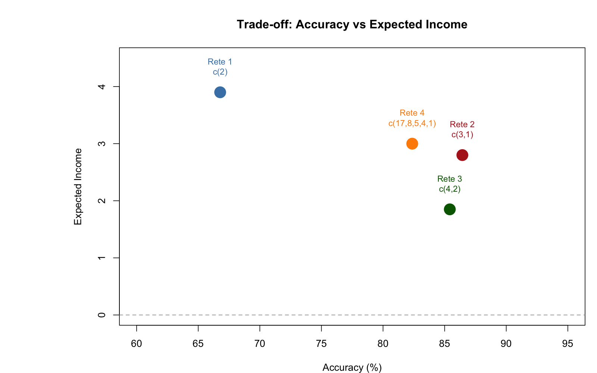
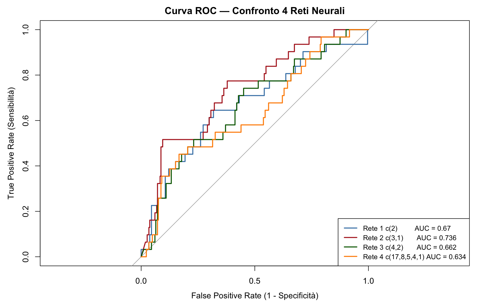

# Credit Risk Modeling with Neural Networks — ATECO Sector 52

> Master's degree project — *L.B., N.F.*
> All rights reserved. See `LICENSE` for details.

---

## Overview

This project implements a **credit risk prediction model** for companies in ATECO sector 52 (retail trade), comparing four neural network architectures trained on real financial data.

The goal is not simply to classify companies as *default* or *performing*, but to identify the configuration that **maximizes the bank's Expected Income**, accounting for the strong class imbalance present in the dataset (≈10% default, ≈90% performing).

---

## Project Structure

```
NeuralNetwork/
├── project.R          # Main R script (full analysis)
├── Sector_52.xlsx     # Dataset — ATECO sector 52 companies
└── README.md
```

---

## Methodology

### 1. Preprocessing
- **Stratified train/test split** (2/3 – 1/3): samples are drawn separately for each class to ensure stable class proportions in the test set despite the imbalance
- **Winsorization** at the 1st–99th percentile (computed on the training set only, then applied to the test set to prevent data leakage)
- **Min-max normalization** to the [0, 1] range
- **Dummy encoding** for categorical variables (region, legal form, ATECO sub-sector)

### 2. Variable Selection
Bidirectional stepwise logistic regression with **4 penalty values** (k = 2, 3, 4, 10). Variables appearing in at least 2 out of 4 models are retained — a threshold that balances parsimony and predictive coverage.

### 3. Neural Network Architectures

| Network | Hidden layers | Notes |
|---------|---------------|-------|
| Net 1 | `c(2)` | Simple baseline |
| Net 2 | `c(3, 1)` | Two layers, compact |
| Net 3 | `c(4, 2)` | Intermediate capacity |
| Net 4 | `c(17, 8, 5, 4, 1)` | Deep architecture |

All networks use a logistic activation function and non-linear output (`linear.output = FALSE`).

### 4. Evaluation

Models are not evaluated solely on accuracy or AUC, but through business-oriented metrics:

- **Expected Income**: `(TN × 0.05) − (FN × 0.45)` — the bank's expected gain given assumed interest rates and LGD
- **Efficiency**: the model's position between the worst-case and perfect-case scenarios
- **Balancing Spread**: the minimum interest rate needed to break even on false-negative losses
- **ROC curve and AUC** for each network
- **Automatic cut-off optimization** across the range 0.01 – 0.45

## Results

With the cut-off optimised separately for each network (test set, 295 companies):

| Network | Hidden layers | Cut-off | Accuracy | AUC | Expected Income | Efficiency | Balancing spread |
|---|---|---|---|---|---|---|---|
| **Net 1** | `c(2)` | 0.02 | 66.8% | 0.670 | **3.90** | **65.8%** | **2.80%** |
| Net 4 | `c(17, 8, 5, 4, 1)` | 0.21 | 82.4% | 0.634 | 3.00 | 62.4% | 3.70% |
| Net 2 | `c(3, 1)` | 0.25 | 86.4% | 0.736 | 2.80 | 61.7% | 3.86% |
| Net 3 | `c(4, 2)` | 0.06 | 85.4% | 0.662 | 1.85 | 58.2% | 4.24% |

**The most accurate model is not the most profitable one.** Net 1, the simplest architecture, has the lowest accuracy but the highest Expected Income and the lowest break-even spread: its very low cut-off rejects more borderline applicants, and because a missed default costs far more than a lost good client (LGD 45% vs a 5% margin), avoiding false negatives pays off. Net 2 has the best AUC, so it ranks companies best overall, but at its optimal cut-off it accepts more defaults.


*Accuracy vs Expected Income for the four networks: Net 1 is the least accurate but the most profitable.*


*ROC curves of the four networks on the test set.*

---

## Requirements

```r
install.packages(c("readxl", "fastDummies", "neuralnet", "pROC", "DescTools"))
```

R ≥ 4.0 recommended.

---

## Usage

1. Clone the repository
2. Place `Sector_52.xlsx` in the same folder as `project.R`
3. Run `project.R` in RStudio or from the terminal with `Rscript project.R`

---

## License

This project is protected by copyright. See the [`LICENSE`](LICENSE) file for full terms.  
**Reusing, copying, modifying, or redistributing** the code or data without explicit written permission from the authors is not permitted.
